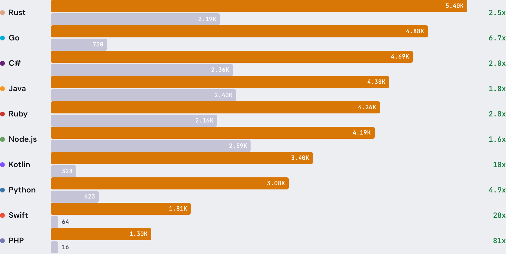
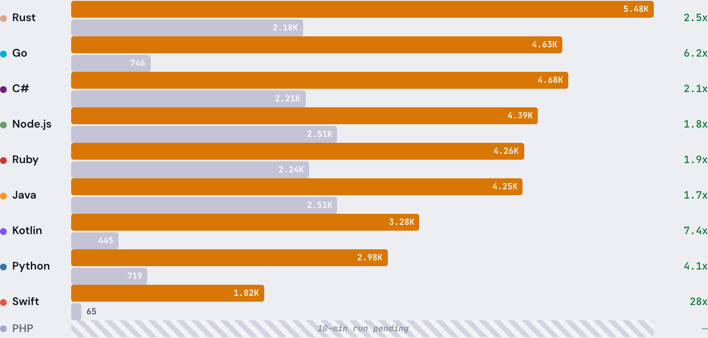

# Every test we've run.

HTTP throughput across 10 languages. 19 frameworks. Chaos resilience. Stress testing. Runtime comparisons. All open source. All reproducible.

Tested April 7, 2026 · zeromcp-benchmarks v1.0 · Reviewed by ZeroMCP Team

Performance

## Faster than every official SDK. Every language.

Mixed workload. 7 method types. Production-realistic traffic. Same machine, Docker containers. [Run them yourself.](https://github.com/antidrift-dev/zeromcp-benchmarks)

### 5-minute sustained

 

### 10-minute sustained

ZeroMCP req/s Official SDK req/s

Built-in sandbox. Credential injection. 21 chaos attacks survived. [See the security model.](https://github.com/antidrift-dev/zeromcp)

[Full benchmarks →](./README.md) [All comparisons →](https://antidrift.dev/zeromcp/comparisons)

* * *

JS Runtimes

## Node vs Bun vs Deno

ZeroMCP and the Official SDK tested on all three JavaScript runtimes. Same tool, same machine.

**Bun** 12.04K req/s 24ms startup · 73 MB

**Deno** 11.10K req/s 34ms startup · 81 MB

**Node.js** 9.74K req/s 47ms startup · 59 MB

[Full runtime comparison →](./node-vs-bun-vs-deno.md)

* * *

Methodology

## Don't trust our numbers. Run them yourself.

[Open source harness.](https://github.com/antidrift-dev/zeromcp-benchmarks) Docker containers, pinned versions, reproducible results.

**Transport**

JSON-RPC 2.0 over HTTP POST. The protocol MCP clients use in production.

**Environment**

Server in Docker (Ubuntu 24.04). Client on host. Docker stats for memory and CPU.

**Duration**

5-minute and 10-minute sustained load. Mixed workload across all 7 MCP method types. Snapshots every 10 seconds.

**Metrics**

Throughput (req/s), latency (p50/p99), memory (VmRSS), CPU (utime + stime).

[Run it yourself on GitHub →](https://github.com/antidrift-dev/zeromcp-benchmarks)

* * *

Chaos Testing

## Resilience and stress testing

### Level 1: Resilience

-   22 fault-injection attacks
-   10 languages tested
-   4 categories: protocol, payload, tool behavior, stress
-   ZeroMCP: 21-22/22
-   Official SDKs: 19-21/22
-   21 bugs found and fixed before v0.1.0

[See the results →](./chaos-resilience.md)

### Level 2: Stress

-   15 advanced attacks
-   10MB payloads, 1K concurrent, max int IDs, wrong types
-   6 third-party frameworks tested
-   ZeroMCP: 37/37 combined (L1 + L2)
-   Best competitor: 36/37
-   Only framework to pass every attack

[See the results →](./chaos-resilience-2.md)
