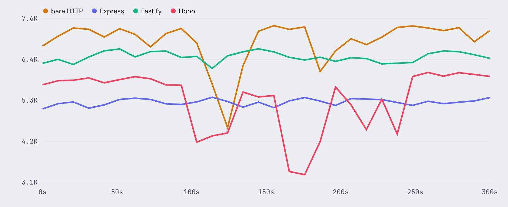

Node.js Frameworks

# Express vs Fastify vs Hono

ZeroMCP embedded as a handler function in 4 Node.js HTTP frameworks.  
300-second sustained load. Same tool. Same machine.

Tested April 7, 2026 · zeromcp-benchmarks v1.0 · Reviewed by ZeroMCP Team

5.07K req/s bare http

4.88K req/s Fastify

4.39K req/s Hono

4.02K req/s Express

## Time-series: 300 seconds

Every 10 seconds, a snapshot. Toggle metrics to see throughput, latency, and memory over time.

   

**Hono memory leak fixed in v0.1.1.** Schema caching eliminated per-request allocation. Hono now holds steady at 75-76 MB over 5 minutes — same stability as Express and Fastify.

* * *

## Summary

| Framework | Avg req/s | p50 | p99 | Memory |
| --- | --- | --- | --- | --- |
| bare http | 5.07K | 0.17ms | 0.41ms | 24-28 MB |
| Fastify | 4.88K | 0.17ms | 0.51ms | 85-86 MB |
| Hono | 4.39K | 0.19ms | 0.57ms | 75-76 MB |
| Express | 4.02K | 0.21ms | 0.74ms | 74-78 MB |

* * *

## What this means

**bare http wins on throughput and memory**

5.07K req/s at 24-28 MB. No middleware overhead. If your MCP server is the only thing on the port, use bare http.

**Fastify is the best framework choice**

4% slower than bare http, but you get routing, middleware, and plugins. Stable memory at 85 MB.

**Express is fine**

21% slower than bare http — still 4.02K req/s. If your team already uses Express, stay there.

**Hono memory leak is fixed**

v0.1.1's schema caching eliminated the leak. Hono now holds steady at 75-76 MB. Solid middle ground between Express and Fastify.

[← All benchmarks](./README.md) [Node vs Bun vs Deno →](./node-vs-bun-vs-deno.md)
