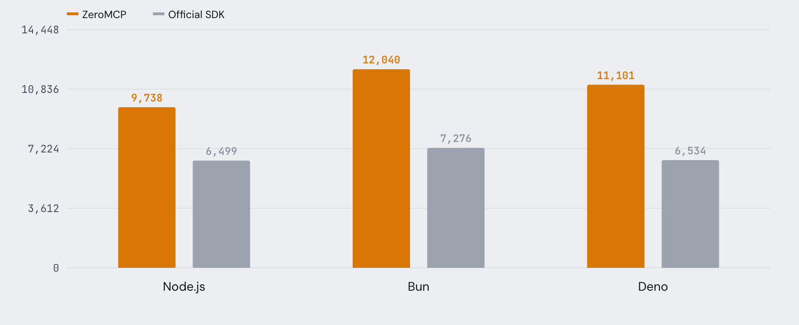

JS Runtimes

# Node.js vs Bun vs Deno

ZeroMCP and the Official MCP SDK tested across all three JavaScript runtimes.  
Same tool. Same machine. stdio transport.

Tested April 7, 2026 · zeromcp-benchmarks v1.0 · Reviewed by ZeroMCP Team

12.04K req/s Bun + ZeroMCP

11.10K req/s Deno + ZeroMCP

9.74K req/s Node + ZeroMCP

24ms startup Bun (fastest)

## Head to head

ZeroMCP (amber) vs Official SDK (gray) on each runtime. Toggle metrics.

   

* * *

## Full results

| Runtime | SDK | Startup | req/s | p50 | p99 | Memory |
| --- | --- | --- | --- | --- | --- | --- |
| Bun | ZeroMCP | 24ms | 12.04K | 0.07ms | 0.96ms | 73 MB |
| Bun | Official | 52ms | 7.28K | 0.09ms | 1.21ms | 122 MB |
| Deno | ZeroMCP | 34ms | 11.10K | 0.09ms | 0.21ms | 81 MB |
| Deno | Official | 67ms | 6.53K | 0.14ms | 0.45ms | 140 MB |
| Node.js | ZeroMCP | 47ms | 9.74K | 0.09ms | 0.30ms | 59 MB |
| Node.js | Official | 120ms | 6.50K | 0.14ms | 0.34ms | 107 MB |

* * *

## What this means

**Bun is fastest across the board**

24ms startup, 12K req/s with ZeroMCP. 65% faster than the official SDK on Bun.

**Deno has the best tail latency**

0.21ms p99 — the most consistent runtime. No outlier spikes over the test window.

**Node.js uses the least memory**

59 MB peak with ZeroMCP. Mature V8 GC keeps it tight. Still 9.7K req/s.

**ZeroMCP wins on every runtime**

1.5-1.7x faster than the official SDK regardless of runtime. The gap is the SDK, not the engine.

[← Framework comparison](./express-vs-fastify-vs-hono.md) [All benchmarks →](./README.md)
